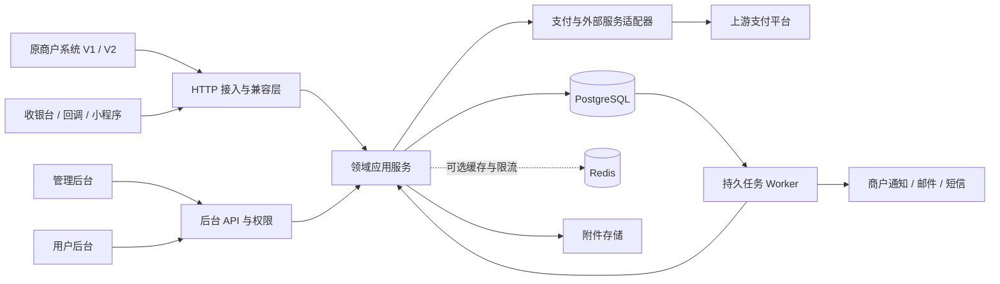

# GOEPAY：Go + PostgreSQL 总体设计与落地规划

日期：2026-10-23。版本：设计基线 v0.1。源码位置：`E:\GOEPAY`。

## 1. 目标和设计结论

以 `epay_pro` 为产品与业务基准，以 `epay_release` 明文实现、Pro 自带文档和 SDK 为交叉证据，重建完整支付平台。保持现有商户接入协议、支付结果通知与交易语义，管理后台和用户后台菜单及功能逐项对应，同时改善资金一致性、可维护性、安全性和可观测性。

采用 **Go 模块化单体 + PostgreSQL + Vue 3 / TypeScript 双后台**。同一 Go 代码库分为 API、后台任务、管理 CLI 三类入口；兼容层、领域服务、支付通道适配器明确隔离。初期使用 PostgreSQL 持久任务表与事务 Outbox；Redis 按多实例会话、限流和缓存需求启用，不以 Redis 锁保证资金正确性，也不先引入独立消息队列。

“完全对应”是上线验收条件，不等于复制 PHP 数据结构或沿用不安全的内部实现。菜单、按钮、表单、权限、批量操作、导入导出、后台任务、第三方接入、错误路径均属于范围。不能只完成几个主要支付接口后宣布整体替换。

本稿已经完成静态证据梳理和总体设计，但没有运行 PHP、连接数据库、调用真实支付通道或验证生产行为。加密行为、缺失插件与文档矛盾见第 3 节及兼容规范，关闭这些问题是完整验收的前置条件。

## 2. 已阅读的资料及统计口径

| 资料 | 已核实内容 | 局限 |
|---|---|---|
| `epay_pro/app/view/doc/*.html`，24 个页面 | V1/V2 请求、返回、签名、通知、退款、代付、投诉 | 文档有遗漏、矛盾，示例不一定列全返回字段 |
| `epay_pro/public/static/files/SDK.zip`、`SDK_2.0.zip` | PHP SDK 的签名、请求地址、响应验签、300 秒时间戳检查 | 已只读检查核心类，未实际执行 |
| `epay_pro/app/data/menu_admin.json` | 66 个菜单节点，54 个叶子页面，其中 3 个隐藏页 | 动态扩展菜单尚不在本地包中 |
| `epay_pro/app/data/menu_user.json` | 33 个菜单节点，28 个叶子页面，其中 1 个隐藏页 | 登录、找回密码和弹窗功能不都在菜单中 |
| `epay_pro/route/{admin,user,api,app}.php` | 静态路由分别为 344、173、22、33 条，共 572 条 | 不含运行时插件注册路由、PHP 入口别名和路由未命中处理 |
| Pro 安装 SQL 和 update2～5 | 安装基线 38 张表；增量脚本揭示历史字段变化 | 安装脚本不等于实际生产数据库结构 |
| Release 安装 SQL 和更新脚本 | 安装基线 29 张表 | 有 Release 独有表，需要迁移核对 |
| Release API、Payment、ApiHelper、functions、cron | 可读的签名、兼容接口、资金处理和通知逻辑 | 不能推定新版加密代码与其完全相同 |
| Pro plugins 与 Release plugins | Pro 4 类业务插件目录为空；Release 有 60 个支付插件入口文件 | 入口存在不代表所有能力都可用或仍可接入 |
| Pro 前端入口与静态资源 | 双后台编译资源，存在 Vue 与 Element Plus 构建产物 | 未提供可直接维护的前端源码工程 |

`docs/baseline/` 保存逐项 CSV、文件哈希和可复现统计。99 个 Pro PHP 文件以 `swoole_loader` 标记开头；这是加密标记检测数量，不是全代码审计结论。Swoole Loader 与 Swoole 协程服务并非同一概念：当前能确认 Loader 依赖及命令/异步任务结构，实际生产是否以 Swoole 常驻 HTTP 服务运行仍需部署配置证明，性能基准不能凭名称推定。

## 3. 当前缺口与处理决定

| 编号 | 证据 / 缺口 | 本设计的处理 | 关闭条件 |
|---|---|---|---|
| GAP-01 | Pro `payment/applyments/complain/addons` 目录均为 0 文件 | 预留全部能力域、插件注册和管理功能；Release 60 个插件逐一核对，不视为 Pro 的完整替代 | 获得实际启用和可安装插件清单、包及版本；逐插件能力验收 |
| GAP-02 | 99 个核心 PHP 文件带 Loader 标记 | 依据文档、路由、SDK、明文旧版和合法可运行旧系统建立行为样本，不猜测加密函数实现 | 每个关键行为拥有原版输入输出或业务确认记录 |
| GAP-03 | 前端仅有构建产物 | 新建可维护 Vue 工程，保留原菜单结构、操作能力与重要交互；从静态资源和运行界面采集字段、按钮、校验规则 | 82 个叶子页面及非菜单流程均有字段/操作/权限验收条目 |
| GAP-04 | 缺实际数据库、配置、历史订单与流量数据 | 先确定模型与迁移工具；不虚构生产规模、费率优先级、时区与负余额规则 | 脱敏 schema、业务配置、数据分布、迁移演练和容量基线 |
| GAP-05 | 应用市场依赖原厂外部服务 | 保留账户、授权、购买、充值、下载、模板删除等操作范围；设计独立 Marketplace 适配器 | 确认原服务可用接口、授权和包格式；若无法接入，记录未达成项，不能以静态市场页面替代验收 |
| GAP-06 | Pro 文档、路由和 Release 行为不一致 | 设置版本兼容画像和差分测试，不将 Release 推断强写为 Pro 事实 | 兼容文档中的差异项逐一有测试样本与定论 |

上述缺口不阻止架构、基础设施和已知协议的开发，但会阻止对应功能宣告“完全兼容”和最终全量切换。当前规划不缩减需求。

## 4. 功能范围与模块边界

完整菜单路径、角色和隐藏页见 [功能索引](../baseline/feature-index.md)；所有静态动作见 [路由台账](../baseline/routes.csv)。下表定义业务归属，不能替代逐项台账。

| 模块 | 必须覆盖的能力 | 关键边界 |
|---|---|---|
| identity | 管理员/商户登录、TOTP、注册审核、付费注册、找回密码、验证码、第三方登录、SSO、密码和支付密码 | 商户 API 密钥与后台会话隔离；代登录审计 |
| merchant | 商户增删改查、组与组购买、费率配置、实名、保证金、充值、域名、邀请码、邀请返现、账户设置 | 一切资金变化交给 ledger；旧 ID 保持可映射 |
| payment | V1/V2 下单、查询、收银台、付款码、JSAPI、APP、小程序、聚合码、子订单、预授权、冻结/解冻、补单 | 支付状态、资金冻结和结算状态分开建模 |
| channel | 支付方式、通道、子通道、进件绑定、通道轮询、权重、额度、公众号小程序、证书、余额查询、测试支付 | 记录决策版本和真实尝试；未知结果禁止随意换通道 |
| refund | 全额/部分退款、退款查询、退款记录、API 开关、渠道退款和平台账务 | 累计成功及处理中预占金额不能超过可退款额 |
| ledger | 资金明细、可用/冻结/保证金/结算中账户、充值、扣款、冲正、内部转账 | 唯一资金写入口，复式分录和余额同事务 |
| settlement | 结算配置、申请提现、审核、批量结算、自动结算、付款回执、导出 | 提现申请即预占；处理中不能重复出款 |
| transfer | 代付、单笔/批量/红包、撤销、退回、凭证、账号/通道/商户统计 | 上游不确定态必须查证；用户确认页独立建模 |
| profitsharing | 渠道分账规则与记录、查询、解冻、回退、站内分账、延迟结算 | 渠道分账和站内分账不混为一种资金流 |
| onboarding | 进件渠道、动态表单、材料、银行卡核验、签约、查询、通道绑定、进件交易/报表 | 每渠道字段、枚举、操作能力独立配置 |
| complaint | 投诉同步、详情、图片、回复、补充举证、处理、退款审批反馈、完结、统计、任务 | 同意退款不等于已执行退款；每次外部操作可审计 |
| risk | 黑名单、商品限制、域名、频率、金额、地区、买家实名/年龄、商户管控、通道风险 | 决策留痕；身份敏感数据最小化暴露 |
| notification | 商户支付通知、事件订阅、短信、邮件、QQ 机器人、收款语音、打印、日报、余额提醒 | 支付成功提交与消息投递分离，逐目标重试 |
| reporting | 日交易、商户、通道、地区、买家、代付、投诉统计 | 可异步汇总；余额与查单走权威事务数据 |
| system | 系统设置、计划任务、公告、管理员权限、登录/运行日志、缓存、数据清理、更新 | 保留操作目的；不可清理不可变资金账本 |
| extensions | 应用市场、本地插件、模板、扩展、聚合收款码样式及隐藏编辑页 | 原 PHP 插件不能直接加载到 Go 进程 |

特别纳入非菜单功能：首次资料补全、验证码、第三方授权回跳、OpenID 获取、API 密钥生成/重置、TOTP 绑定解绑、收银台验证、商户退款开关、测试支付、收款语音与打印、事件订阅、红包领取、微信转账确认、小程序收银台、公开官网与文档、初始化安装、命令行运维。

## 5. 架构



### 5.1 部署进程

- `cmd/api`：HTTP、兼容接口、后台 API、支付回调、健康检查；无本机独占业务状态。
- `cmd/worker`：通知、查单、退款查证、结算、分账、投诉同步、进件刷新、日报和导出。并发按任务类别、通道和商户限制。
- `cmd/cli`：初始化、迁移、对账、修复任务、导入、备份验证。危险操作要求显式参数、审计和预览。
- 静态双后台由反向代理提供；支付页可由 Go 模板和独立轻量前端提供，避免后台 bundle 拖慢支付页面。
- 本地开发使用 Compose；生产先采用受控进程或容器部署，API、Worker 可独立扩容。没有规模证据前不引入 Kubernetes 和微服务拆分。

### 5.2 技术选型

| 层 | 选型 | 原因和约束 |
|---|---|---|
| HTTP | Go 标准库 `net/http` | 标准 context、超时与调试体系；框架选择不决定资金正确性 |
| 持久化 | PostgreSQL 18 系列；实施时锁定受支持补丁版 | 事务、唯一约束、行锁、JSONB；不使用候选发布版 |
| SQL | pgx v5 + sqlc + 显式迁移 SQL | 金融 SQL 可审查；生成类型安全访问；关键逻辑不隐藏在 ORM 回调中 |
| 前端 | Vue 3、TypeScript、Vite、Vue Router、Pinia、Element Plus | 与原构建产物技术方向一致；双应用共享组件和类型 |
| 缓存 | 初期可无；多实例时可启用 Redis | 缓存、集中限流、会话辅助；数据库是资金和任务的事实来源 |
| 任务 | PostgreSQL jobs + outbox + inbox | 数据与任务意图同事务；重启后恢复；无需双写消息中间件 |
| 文件 | 存储接口；单机私有目录，生产支持 S3 兼容对象存储 | 进件与投诉附件隔离授权；不放可执行 Web 目录 |
| 观测 | 结构化日志、OpenTelemetry 接口、Prometheus 指标 | 关联订单和任务；敏感信息不进标签或明文日志 |

Go、Node、前端库及构建工具在开工时选择受支持稳定版本并锁入工具链配置与 lockfile，本稿不猜测未来补丁号。PostgreSQL 官方提供版本支持策略；pgx 和 sqlc 官方提供 PostgreSQL 驱动及生成访问代码的组合说明。参考：[PostgreSQL 版本策略](https://www.postgresql.org/support/versioning/)、[pgx](https://github.com/jackc/pgx)、[sqlc 与 pgx](https://docs.sqlc.dev/en/stable/guides/using-go-and-pgx.html)。

## 6. 仓库结构与代码规范

```text
GOEPAY/
  epay_pro/                         # 只读参考输入
  epay_release/                     # 只读参考输入
  cmd/{api,worker,cli}/main.go
  internal/
    bootstrap/                      # 组装依赖与生命周期
    compat/{v1,v2,legacyphp}/        # PHP 语义、参数、签名、错误、旧地址
    identity/ merchant/ payment/ channel/ refund/
    ledger/ settlement/ transfer/ profitsharing/
    onboarding/ complaint/ risk/ notification/ reporting/ system/
    adapters/{payment,mail,sms,marketplace,storage}/
    platform/{postgres,jobs,httpclient,security,telemetry,config}/
  db/{migrations,queries,generated}/
  api/{openapi,compatibility}/
  web/
    apps/{admin,merchant,cashier}/
    packages/{ui,api-client,contracts,utils}/
  tests/{contract,integration,e2e,load}/
  testdata/{compat,provider}/
  deploy/{compose,proxy}/
  docs/{design,baseline,adr,runbooks,superpowers/plans}/
  go.mod / go.sum / Makefile
```

每个业务模块内部按实际需求设置 `model.go`、`service.go`、`repository.go`、`handler.go`、`errors.go` 及测试；文件过大时按用例拆分，例如 `refund/service.go` 进一步拆成 submit/query/reconcile，避免全局超大 service 和无边界 `utils`。

依赖方向：HTTP/Worker → 应用服务 → 领域规则与仓储接口；PostgreSQL/通道适配器实现接口。领域不依赖 HTTP、Redis 或 PHP DTO。共享是共享稳定类型和能力，例如 Money、Clock、ID、鉴权主体、分页；不为了复用把不相关业务塞进通用 CRUD 基类。

规范：

1. `context.Context` 作为 I/O 方法首参，所有外部请求和数据库操作有超时；后台任务使用自身生命周期，不沿用已取消的浏览器请求。
2. 业务错误类型化，由各协议适配器映射旧码或新码；禁止吞错、直接向用户返回堆栈/SQL/密钥。
3. 金额不经过 `float32/float64`；前端不计算最终手续费，不用 JavaScript Number 表示大 ID 或账本金额。
4. 事务由用例服务明确开启和传递，事务内不得误用连接池执行独立 SQL；禁止持有账本行锁调用外部 HTTP。Go 官方说明事务内混用非事务句柄会造成不一致或死锁风险：[事务文档](https://go.dev/doc/database/execute-transactions)。
5. SQL 参数化，动态排序列使用白名单；生成代码只通过生成器修改；migration 经审查，不直接修改已执行版本。
6. 日志中 key、私钥、签名原文、身份证、银行卡、手机号和完整 URL 查询参数按规则屏蔽；调试开关不能绕过脱敏。
7. 同一领域逻辑供 V1、V2 和后台调用，协议层只做适配，禁止复制三份下单/退款业务。
8. 原始 PHP 包、SDK、图片和第三方库登记来源与授权；实现优先独立 Go 代码，复用资源保留必要版权和许可证记录，不把压缩 JS 当新工程源码。
9. CI 执行格式化、静态检查、竞态检查、契约/资金集成测试、前端类型检查和构建；金融核心改动必须提供失败重试/并发场景证据。

## 7. API 与兼容边界

对外兼容必须包含地址、方法、表单编码、字符串化、空值、签名、成功/错误码、可选字段、重定向、回调 ACK 与重试行为；详细规则见 [兼容规范](2026-10-23-compatibility.md)。

- 保留 `/submit.php`、`/mapi.php`、`/api.php?act=...` 与 `/api/pay/*`、`/api/transfer/*`、`/api/merchant/*`、`/api/complain/*`。
- `/pay/:payapi_func/:payapi_trade_no`、旧回调和页面别名、`/api.php?s=...` 的兼容性按原版本核实，不简单统一重定向，防止改变 POST 或回调签名。
- 旧商户保持 PID、API 密钥、平台公钥对应私钥及订单标识的连续性；密钥迁移必须加密。若无法迁移平台私钥，无法对已部署 SDK 宣称零改动兼容。
- 新后台用 `/console/v1/admin/*` 与 `/console/v1/merchant/*`，避免与原支付 `/api/*` 混淆。原后台路由是功能对照表；若需要原后台构建产物继续工作，再增加其响应兼容适配，不能让新后台直接依赖 PHP 命名。
- 新后台 JSON 响应为 `{code,message,data,request_id}`，HTTP 状态表达认证/权限/冲突/校验/系统异常；金额和大整数 ID 用字符串，日期用 RFC3339。旧支付接口不套该 envelope。
- OpenAPI 记录内容类型、认证、参数长度、金额单位、错误、分页、示例；前端客户端从契约生成。字段新增保持兼容，删除/语义改变需新版本。
- 后台新增写操作只用 POST/PUT/PATCH/DELETE。旧后台 GET 写操作是迁移与安全评估项，不能直接复制到新 API。

## 8. 支付、退款与资金一致性

### 8.1 金额与状态模型

核心人民币金额采用 `BIGINT` 分单位，Go 使用带币种/精度约束的 Money 类型，外部仍输出 `"1.00"`。费率采用定点整数或 `NUMERIC`，计算中使用检查溢出的整数/任意精度中间值；费率单位、舍入阶段、上下限必须按旧版样本固定。数据库 `numeric` 是精确小数，浮点不是：[PostgreSQL 数值类型](https://www.postgresql.org/docs/18/datatype-numeric.html)。

保留订单名义金额、买家实付、商户应得、通道成本、平台手续费、退款金额等独立字段及费率快照；不得用一个 money 覆盖。非人民币或超两位小数通道若在插件盘点中发现，必须扩展币种精度与适配器，不能默认全部换算成人民币分。

内部状态分开维护：

- 支付：`created → submitting → pending → paid / closed / failed`，另有需要查证的 `unknown`。
- 预授权：`authorized → captured / released`，不可视作普通已付款。
- 冻结：资金冻结/解冻独立状态与账本事件；旧 `status=3` 由适配层映射。
- 退款：`requested → reserved → submitting → processing / unknown → succeeded / failed`，每笔退款独立。
- 代付/结算：`requested → reserved → approved → submitting → processing / unknown → succeeded / failed / cancelled`；只有证实可撤销时进入 cancelled。
- 分账：独立执行与回退记录，关联原交易、接收者和规则版本。

原 API 支付状态 0/1/2/3/4、代付状态 0/1/2 保持原定义；部分退款和未知态如何映射必须有契约样本，不直接向旧客户端暴露新枚举。

### 8.2 下单与通道选择

1. 协议层按原始字段规则验签，然后解析业务数据并检查商户归属、开关、限额、域名及通道能力。
2. 事务创建订单，唯一键 `(merchant_id, out_trade_no)` 防止重复；相同订单号且业务参数一致返回既有结果，冲突参数按旧协议返回冲突错误。
3. 固化订单金额、费率和通道决策快照，生成稳定的通道请求号并记录 attempt 后提交事务。
4. 事务外调用上游，保存上游单号和支付材料；网络超时标记 unknown 并排队查证。
5. 只有上游明确未受理且规则允许时才重试或切换通道；超时立即切通道可能产生双付，禁止如此实现。

轮询、权重、日限额、时间段、设备、用户组和商户指定通道优先级通过旧版样本确定；每次决策可解释。额度预占须可并发校验且持久化，缓存不可独自决定是否超限。

### 8.3 支付成功事务

上游回调按原始报文验签、验证商户/通道/订单/金额/币种/交易状态，先校验真实性再进行状态推进。浏览器 return 只展示结果，不作为收款凭据。

单一数据库事务内：回调事件去重 → 锁定订单 → 检查允许状态转换 → 写入成功事件 → 生成资金分录与更新余额 → 写 Outbox。提交成功后才向上游返回成功 ACK。数据库失败返回可重试响应。重复真实回调允许重新 ACK，但不能再次入账。

幂等键分三层：上游事件键、订单状态转换键、账本业务事件键；上游事件 ID 缺失时，采用明确可验证的通道/业务号/事件类型组合，不能只依赖易变化的报文哈希。

### 8.4 账本

`ledger_transactions` 为业务凭证，`ledger_entries` 为不可变分录，`ledger_accounts` 为账户，`account_balances` 为事务维护投影。每笔凭证同币种借贷相等；可用、冻结、保证金、结算中、平台费用、通道清算分别建账户。账户类别的借贷方向在账务规范中定义。

入账仅通过统一 Posting 服务和受限数据库角色。跨行借贷平衡不能靠普通单行 CHECK，需服务端校验并配合提交时的延迟约束触发器或受控记账函数；业务键唯一约束兜底。余额变更与分录同事务；多账户锁按固定账户 ID 顺序，避免互相转账死锁。

收入示例（平台代收模式）：借通道应收 100.00，贷商户可用 99.00、贷平台手续费收入 1.00。商户直收模式通常只收服务费，不能凭此示例制造平台持有的收款余额。Release `functions.php::processOrder` 已显示通道 mode 与订单 tid 会改变账务处理，必须分别建模并核实 Pro。

资金修正使用反向分录/冲正，不改原始账。原“删除资金明细”“清理订单”“手工改支付状态”保留业务操作入口及必要能力，但底层采用归档、视图隐藏、审计调整和状态机；任何无法安全等价的行为列入差异审查，不允许静默删除按钮或伪造余额。

### 8.5 退款与出款

退款在订单锁下预占可退款金额，成功与处理中退款总额不得超过实收可退金额。重复外部退款号返回同一退款；同号金额不同拒绝。上游成功但本地保存失败必须通过相同业务号查证，不能重复发起新号退款。

代付、提现、站内转账使用资金预占，失败时释放，成功时完成记账；unknown 不释放预占。站内转账需要审核的场景先冻结发起方，审核通过后一次事务完成收付双方分录；拒绝仅释放一次。允许负余额的业务仅可通过显式授信规则与额度实现，不能默认关闭所有余额约束，也不能在未核实前迁移时直接删除旧负余额。

旧协议允许省略 `out_refund_no/out_biz_no`。不增加必填条件；同一次平台 attempt 始终用稳定编号。无外部幂等号时，不能保证区分“客户重试”与“客户有意再付一次”，必须在兼容说明和运维中明确，不能按金额/收款人粗暴全局去重。

## 9. PostgreSQL 模型与迁移设计

下面覆盖全部 38 张 Pro 安装表；映射是新设计，并非已建表。

| 原表 | 新模型归属 |
|---|---|
| pre_config | system_settings、secret_refs、settings_revisions |
| pre_crontab | scheduled_tasks、task_runs、jobs |
| pre_anounce | announcements |
| pre_type | payment_methods |
| pre_plugin | plugin_installations、plugin_capabilities |
| pre_channel | payment_channels、channel_credentials、channel_limits |
| pre_roll | channel_routing_rules |
| pre_weixin | wechat_applications |
| pre_order | payment_orders、payment_attempts、order_events |
| pre_group | merchant_groups、group_prices、group_policies |
| pre_user | merchants、merchant_credentials、merchant_profiles、merchant_settings、account_balances |
| pre_settle | settlements、settlement_items |
| pre_log | auth_logs、audit_events |
| pre_record | legacy_balance_records + 新 ledger_transactions / ledger_entries |
| pre_batch | settlement_batches |
| pre_regcode | verification_challenges、registration_flows |
| pre_risk | risk_events |
| pre_domain | merchant_domains |
| pre_psreceiver | profitsharing_rules、profitsharing_receivers |
| pre_psinternal | internal_profitsharing_rules |
| pre_internal_transfer | internal_transfers |
| pre_psorder | profitsharing_orders、profitsharing_attempts、profitsharing_returns |
| pre_subchannel | merchant_subchannels |
| pre_blacklist | risk_blocklist |
| pre_transfer | transfers、transfer_attempts、red_envelopes |
| pre_invitecode | invitation_codes、invitation_usages |
| pre_refundorder | refunds、refund_attempts |
| pre_suborder | payment_suborders |
| pre_complain | complaints、complaint_messages、complaint_operations |
| pre_complaintask | complaint_sync_tasks |
| pre_applychannel | onboarding_channels |
| pre_applymerchant | merchant_applications、application_revisions |
| pre_applytrade | onboarding_trades |
| pre_applyreport | onboarding_reports |
| pre_mchrisk | merchant_restrictions、restriction_events |
| pre_attachment | attachments、attachment_grants |
| pre_adminuser | administrators、roles、permissions、role_bindings |
| pre_onecode | collection_code_styles、merchant_collection_codes |

新增关键模型：`callback_inbox`、`outbox_events`、`notification_deliveries`、`idempotency_records`、`sessions`、`reconciliation_runs`、`reconciliation_differences`、`export_jobs`、`import_runs`、`legacy_id_mappings`。会员购买、邀请返现、注册付费和充值订单增加业务关联表，避免完全依赖不可查询的 param 文本。

设计约束：

- 商户订单唯一键、商户退款号/代付号部分唯一索引、上游事件唯一键、账本业务键唯一索引。空外部号必须归一为 NULL，不能让空字符串占用唯一键。
- 订单号保留字符串语义，历史编号原样保存；新号码生成要满足旧客户端长度约束与多节点唯一性，不能直接将 19 位订单号替换成 UUID 字符串。
- 新时间列为 `timestamptz`；业务日和旧日期输出使用原站点配置时区。用户当前时区不能证明 PHP 生产站时区。
- 状态用显式检查约束或字典，关系加 FK；删除使用归档标记，禁止级联删除资金记录。
- JSONB 放渠道扩展参数和版本快照；可查询的状态、金额、商户、通道、时间保持普通列。
- 索引从 `(merchant_id, created_at DESC, id DESC)`、`(channel_id, created_at DESC)`、待处理任务条件索引开始，根据 EXPLAIN 和流量验证，不为每个筛选字段盲目建索引。
- 初期订单和账本不分区。若将来按月分区，需要解决跨分区业务号唯一约束，例如独立全局幂等注册表；不能在没有日期条件时假定分区表能保证全局唯一。

迁移必须处理 MySQL 宽松 SQL mode、零日期、unsigned、空字符串、编码、排序规则及大小写、默认 0 外键、JSON/序列化字段、重复订单号。Pro `BaseCommand.php` 中显式设置空 sql_mode，因此 PostgreSQL 严格校验下的数据清洗不是可省步骤。安装 SQL 与各 update 是版本历史，不能直接顺序重复应用到完整安装 schema。

Release 的 `pre_cache/pre_wework/pre_wxkfaccount/pre_wxkflog` 在 Pro 安装基线中不存在。缓存可重建；其余业务表应迁入兼容档案或相应扩展模型，经确认才可停用，不能丢失历史业务资料。

历史单式流水不强行伪造为完整复式账。迁移时保存原流水，按商户/币种/资金类型建立经核对的期初分录；从切换点开始使用新账本。冻结、待结算、处理中退款/代付必须单独核对，不能把原 money 一列视为全部可用资金。

## 10. 任务、通知与可选中间件

业务数据和 outbox 在同一事务提交；Worker 使用 `FOR UPDATE SKIP LOCKED` 领取批量任务并写租约后立即提交，事务外执行网络操作。完成更新匹配租约 token/版本，过期 Worker 不得覆盖新执行结果。租约本身不能杜绝外部重复，外部业务号和内部幂等仍是必要条件。PostgreSQL 官方将 SKIP LOCKED 的不一致视图明确限定为队列类用途，不用于余额查询：[SELECT 文档](https://www.postgresql.org/docs/18/sql-select.html)。

任务字段至少包括：类型、聚合 ID、业务去重键、payload 版本、状态、attempt、next_run_at、lease_token、lease_until、last_error、created_at。失败分为可重试、业务拒绝和未知结果；指数退避/抖动用于新任务，原通知重试节奏由兼容策略决定。

必须保留 11 类内置计划任务：系统每日维护、自动生成结算、通知重试、查单补单、分账与延迟结算、风控检测、投诉同步、进件状态刷新、余额提醒、自动转账、收款日报；支持原有启停、参数、频率、单次任务和立即执行。Pro crontab 的锁与频率字段属于迁移范围。

通知是至少一次投递。创建通知事件后，每次发送 V2 通知都生成**当前 timestamp 和新签名**；不能重发过期签名包，因为原 SDK 验证时间差不超过 300 秒。订单发生时间保持原值。每次投递记录脱敏目的地、状态码、摘要、耗时和下一次时间；失败可人工重试，业务事件不重复记账。

Redis 只在有具体收益时增加：多实例会话查询热点、跨节点限流或配置缓存。Redis 故障时账务仍由数据库保证；敏感操作限流不可直接失效放行，可使用数据库或受控保守降级。若未来因任务积压隔离需要引入 RabbitMQ/NATS，仍从 Outbox 投递、消费者 inbox 去重，不建立“数据库提交成功但消息永久丢失”的双写路径。

## 11. 前端规划

两个后台独立构建与鉴权边界，复用表格、金额展示、权限按钮、上传、日期范围、分页、详情抽屉和生成 API 客户端。管理后台不复用商户身份令牌；组件复用不能导致数据权限复用。

菜单名称、分组、顺序、路径语义、隐藏页面、角色和入口一一对应；完整列表由源码自动提取。路由 meta 保留原 name 与 stable feature_id，权限后端裁决，前端仅控制显示。配置导致的隐藏功能也要实现并测试开启/关闭路径。

每个页面交付必须包含筛选项、表格字段、枚举、默认排序、详情、按钮、表单校验、批量结果、导出、加载/空/错误状态及权限矩阵。高风险操作显示实际金额、对象和不可逆影响，使用二次认证/审批；不能只用禁用按钮防重。

收银台支持桌面和手机、微信/支付宝/QQ/抖音内置浏览器、二维码、跳转、JSAPI、APP、小程序、付款码，以及失效、取消、等待、成功和回调失败提示。订单查询必须有访问令牌或等价授权，不能仅凭可猜订单号公开敏感信息。

进件动态表单由渠道 schema 定义，字段关联、材料、银行卡支行、签约链接和审核失败原因分别显示。投诉按 showtype 决定可操作按钮。系统设置按配置域分组，重置密钥、第三方账户绑定与实名资料查看单独审计。

样式可改进信息密度、响应式与可访问性，但不擅自合并或移除原功能。采用 Vue 的 TypeScript 工具链并运行 vue-tsc；组件遵循 Element Plus 的一致性和反馈原则：[Vue TypeScript](https://vuejs.org/guide/typescript/overview)、[Element Plus 设计](https://element-plus.org/en-US/guide/design.html)。

## 12. 安全设计与兼容例外

| 风险面 | 具体控制 |
|---|---|
| 商户数据越权 | 每个资源查询与写入同时约束 merchant_id；不能只检查传入 pid；管理员权限与范围独立 |
| 后台认证 | HttpOnly/Secure/SameSite 会话 cookie、会话撤销与轮换、CSRF token；Referer 不作为唯一保护 |
| 密码/TOTP | 新密码使用 Argon2id，参数按部署压测；旧哈希成功登录后升级；TOTP 密钥加密，恢复流程可审计 |
| API 认证 | 保留 MD5 与旧 key 协议于独立兼容入口；V2 验签/时间戳；按商户配置算法，防止 RSA-only 降级 |
| 支付回调 | 上游签名、证书轮换、字段与订单核对；持久化去重；不信任同步跳转 |
| SSRF | 回调 URL、图片代理、代理测试等仅允许适用协议；连接时校验解析地址，拒绝内网/环回/链路本地/云元数据地址，控制端口、重定向、响应大小和超时，防 DNS 重绑定 |
| 文件与模板 | 类型签名校验、大小限制、随机对象键、私有授权；压缩包检查路径穿越/符号链接/压缩炸弹；不执行用户 PHP/模板代码 |
| XSS/注入 | SQL 参数化、模板转义、公告富文本清洗；支付通道 HTML 用受信模板/隔离来源，不进入后台 DOM |
| 密钥 | 平台私钥、MD5 key、通道凭证加密保存，密钥由环境/KMS 引用，限制导出与日志；轮换与旧客户端过渡单独规划 |
| 资金操作 | 幂等、预占、审批、TOTP/支付密码、审计；业务数据库账号不能随意改账 |
| 运维功能 | 更新包签名校验、迁移预检、原子切换；清理只作用允许数据集；禁用对外无认证 cron/安装入口 |
| 外呼 | TLS 证书验证、连接复用、目的地策略；原 SDK 关闭 TLS 验证的实现不复制到新客户端 |

旧协议中的 URL key、MD5、允许 HTTP 回调与未签名数组都是兼容约束，不能宣称已由内部换语言消除。采用 TLS 接入、日志脱敏、权限/资源绑定、限流和可选 IP 白名单降低风险；升级为新签名协议必须是商户显式迁移，不能破坏现有接入。

V2 投诉 images 数组不参与签名，必须验证附件归属与投诉绑定；新后台可使用全报文保护，但不能要求旧 SDK 新增签名字段。新安全策略若拒绝原先合法使用的特殊回调目的地，应先给出影响报告与商户迁移方案，兼容差异必须可见。

## 13. 插件与外部服务迁移

Go 通道按能力拆为 Payment、Query、Refund、Close、Transfer、ProfitSharing、Onboarding、Complaint 等接口，不要求所有插件实现所有方法。注册表返回能力、支付方式、设备、参数 schema、证书要求、错误分类和可用操作；不支持部分退款的通道在执行前明确返回原等价错误。

第一阶段使用编译内置的 Go 适配器；扩展协议用版本化 HTTP/RPC 子进程承载需要动态安装的服务，配置页面可热更新。PHP 插件 ABI 无法原样运行于 Go，本地插件上传/安装功能需识别包类型和运行能力，不假装兼容现有 PHP 文件。

如确需过渡桥接，将旧 PHP 插件运行在隔离适配服务内，只执行通道调用，不修改新账本；接口 mTLS/签名、超时、业务号和审计齐备。桥接仅是阶段性安排，纯 Go 最终完成标准要求目标插件有 Go 等价实现或经确认的替代接入。是否启用桥接由材料盘点结果决定，本轮不部署。

应用市场、模板、更新、邮件/短信等都设独立适配器；第三方服务不能以测试 mock 代替生产完成。Release 60 插件按 `plugins.csv` 建能力矩阵：下单方式、退款、查单、转账、分账、进件、投诉、回调、配置字段、测试环境和版本差异。实现顺序按实际流量与重要性安排，最终未迁移项仍算未完成。

## 14. 性能、容量与可用性验收

当前没有生产峰值 QPS、订单规模或机器规格，不承诺固定 TPS，也不把“Go 更快”作为结论。先在相同硬件、相同功能、相同数据分布、相同上游模拟延迟下测原版与 Go；生产 Swoole/Loader 运行方式也必须记录。

建议首轮实验配置：API 4 vCPU / 8 GiB、PostgreSQL 独立 4 vCPU / 16 GiB / SSD，100 万订单、1 万商户，数据库持久化开启；这是可复现实验配置，不是生产容量建议。负载从 100/300/500/1000 请求每秒逐级提升，混合下单、查单、回调和后台分页；再以单热点商户及多通道复测。

暂定工程验收目标（未实测，完成基准后冻结）：

- 同资源和一致性级别下，可持续吞吐较旧版提高至少 50%，且 p99 不恶化；达不到则分析瓶颈再决定优化，不删功能换吞吐。
- 不含上游网络耗时的查询/下单内部处理 p95 ≤ 100 ms、p99 ≤ 250 ms；回调落库 ACK p95 ≤ 150 ms。上游耗时单独记录。
- 稳态任务入队至领取 p95 ≤ 2 s；通知首次送达耗时另计；大导出不拖慢支付关键路径。
- 超载可背压和限流、无无界 goroutine；重复回调、任务重启、网络超时下无重复资金效果和余额漂移。
- 生产可用性目标暂定 99.95%；RPO/RTO 由业务预算确定。若要求已确认资金记录 RPO=0，需要同步复制/故障转移策略和可用性权衡，单主异步备份不能作此保证。

连接池按 API+Worker 全部副本总预算配置，限制长事务；慢通道采用单独并发池和熔断；查询/报表分别优化；后台异步导出按权限快照与数据时间边界执行，防止大范围扫描耗尽资源。

## 15. 数据迁移、切换与回滚

1. 冻结源版本和配置指纹，导出真实 schema，建立数据清洗报告、唯一键冲突报告与 ID 映射。
2. 多次脱敏演练，导入商户、密钥、通道、组、域名、资料、订单、退款、出款、分账、投诉、附件和历史流水；按业务状态分桶核对数量与金额。
3. 对每个商户生成余额、冻结、保证金、结算中与期初分录核对单；原始资料保留可追溯索引。
4. 只读影子验证允许查单/计算对照，不向两个系统双发真实付款、退款、通知。
5. 切换时先暂停发起资金写操作，接收入口可持久缓存回调，等待在途任务明确状态；完成增量导入和对账后切换唯一写入方，再按顺序处理缓存回调和恢复请求。必须明确入口责任与切换水位，不能靠 DNS 切换防双写。
6. 存量订单保留其处理归属和上游凭证版本；老回调路由继续可达，通过归属分发到唯一处理方。只有新系统持有完整上下文并能验证时才接管。
7. 切换前可直接回到原系统；新系统已有资金写入后，回滚必须暂停业务、导出新交易增量、反向迁移或让新系统继续处理这批订单并逐笔对账，不能简单恢复旧数据库快照。
8. 备份含数据库 PITR、加密密钥与附件一致性，实际执行恢复演练；日志、迁移批次、金额校验和切换水位一并留档。

## 16. 实施阶段与完成标准

实施顺序见 [阶段计划](../superpowers/plans/2026-10-23-goepay-rewrite.md)：证据闭环 → 基础/身份 → 账本 → 交易兼容闭环 → 双后台基础业务 → 结算代付 → 分账 → 进件投诉 → 扩展与系统 → 全量迁移与压测。

完成标准：

- 已知 82 个叶子页面、全部非菜单流程、517 条后台静态路由对应业务能力都有“页面/接口实现—测试—证据”映射；动态插件功能补入同一台账。
- 22 条开放 API、3 个 PHP 主入口与实际存在的别名/回调路径通过版本化契约测试；原 V1/V2 SDK 无改业务代码可运行。
- 每个插件的已承诺能力通过配置、正常、失败、回调、超时、重试和权限测试；缺插件/原厂依赖不能标记完成。
- 金额、费率、分账、退款、出款、重复回调及并发场景通过真实 PostgreSQL 集成测试；测试替身不能替代事务验证。
- 数据迁移总量、分桶金额、商户余额与全部处理中资金责任一致；备份恢复与回滚演练通过。
- 性能比较报告、安全测试、权限矩阵、告警、部署手册和运维恢复手册齐全；所有 GAP 有证据关闭或保留明确未达成状态。

估算不能只按菜单页数给承诺工期。建议完成证据闭环和一个真实通道纵向样板后，按“模块 + 通道能力 + 原厂依赖”估算；前两周可作为基线与样板验证的初始预算，属于估算而非交付承诺。
