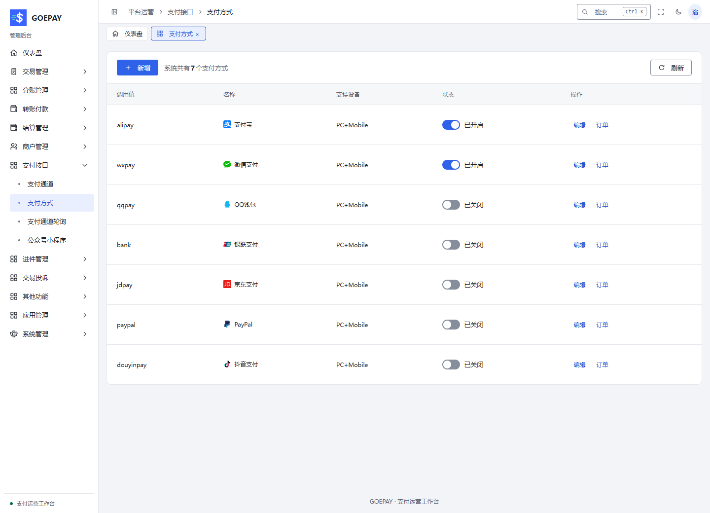

# 支付通道、支付方式与轮询

按功能从[支付方式、通道与路由](../modules/payment-channels.md)开始，先核对通道产品、授权来源与用户组的关系。

## 三个入口的区别

| 入口 | 路径 | 配置的对象 |
| --- | --- | --- |
| 支付通道 | `/admin/payapi/pay-channel` | 服务商、产品、账户凭据和通道限制 |
| 支付方式 | `/admin/payapi/pay-type` | 支付宝、微信等方式的名称、设备范围与开放状态 |
| 支付通道轮询 | `/admin/payapi/pay-roll` | 多个允许通道之间的选取策略 |
| 公众号小程序 | `/admin/payapi/pay-weixin` | 微信应用资料及相应授权配置 |

## 配置一个支付通道

1. 确认服务商已开通所需产品：扫码、手机网页、公众号 / 小程序等不能相互代替。
2. 新增或编辑通道，选择正确支付插件、方式和产品。
3. 按字段填写 AppID、商户号、密钥、公钥或证书等资料。不要把支付宝商户私钥填成平台公钥，也不要混用微信应用与商户身份。
4. 保存后重新读取，核对配置是否完整及通道状态。
5. 配置商户有效用户组和授权来源，使该通道实际可选。
6. 在本地模拟或服务商沙箱验证，检查原单下单、回调、查询和退款。

“配置密钥”“编辑”“测试”等动作取决于账号权限及通道类型。测试可能向服务商提交支付请求，不是无副作用的连通性查看。

## 维护支付方式

编辑方式名称和支持设备，按需启停。`PC+Mobile` 表示电脑和手机都可进入对应方式，具体能使用哪个产品仍由实际通道决定。

本地演示数据。示例中的关闭状态仅用于说明，不代表你的站点配置。

支付宝、微信、QQ 钱包、银联、京东、PayPal、抖音等条目属于方式目录。条目存在不代表已安装适配器、配置账户或取得产品权限。

## 配置轮询

1. 新建轮询组，填写名称及所需规则。
2. 加入已授权的通道，设置有效权重或选取条件。
3. 先保存草稿并检查成员，再启用。
4. 在用户组中选择该轮询组。
5. 核对新订单记录的实际通道；有异常时停用新选择并查询原订单。

轮询不扩大商户权限。通道关闭、限额或风控不满足时，不能通过轮询绕开。已经取得支付材料的原订单不会因为调整轮询而重新选通道。

## 电脑与手机的预期行为

电脑端按产品展示可扫描的完整二维码；手机端按产品能力跳转支付宝或微信，内置浏览器、公众号和小程序另有身份授权条件。二维码、按钮或跳转遇到异常时，保留原订单号，检查原通道和设备产品，避免重复下单。
