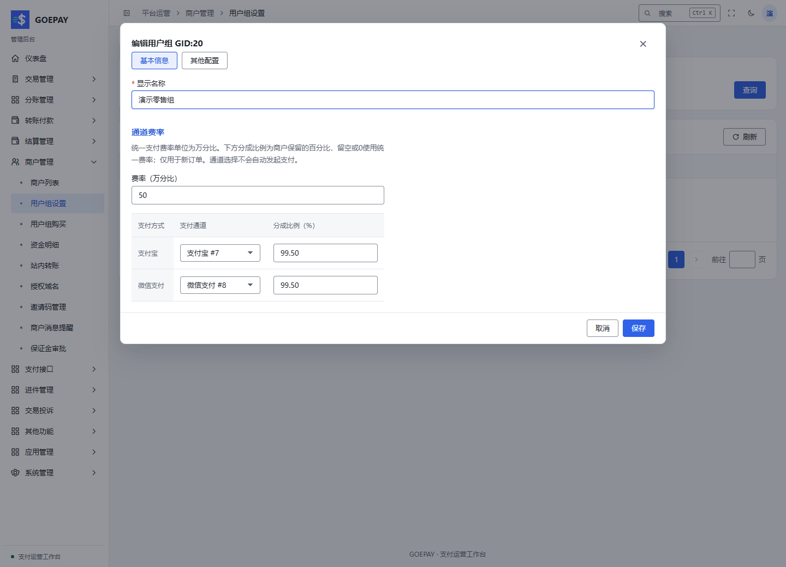

# 用户组、默认通道与费率

按功能阅读[商户与用户组](../modules/merchant-management.md)和[支付方式、通道与路由](../modules/payment-channels.md)，再按本页维护组内策略。

**入口：商户管理 → 用户组设置**，路径 `/admin/merchant/group-list`。

用户组把通道选择与分成比例应用到商户。公共默认通道池、用户组路由和商户显式授权需要同时满足，不是“选了用户组就拥有平台所有通道”。

## 新增用户组

1. 点击 **新增用户组**，填写显示名称。
2. 逐项设置支付宝、微信等支付方式的通道策略。
3. 填写该方式的分成比例，或按页面允许的规则继承。
4. 检查保证金、收款风控等该组可覆盖的政策。
5. 保存后重新编辑，确认选择与数值确实保留。
6. 将演示商户切到该组，由商户本人检查通道和费率。

::: warning 新组必须检查支付方式
新建用户组的支付宝、微信等方式可以默认处于关闭状态。请明确选择有效通道或允许的继承策略；不要保存后直接以为它已经能收款。默认组 GID 0 有保护，不按普通临时组删除。
:::

本地演示用户组。99.50% 为分成比例示例，不是建议采用的生产费率。

## 理解通道选择

| 页面选择的含义 | 使用时检查 |
| --- | --- |
| 关闭该方式 | 该组不能通过此方式发起新收款 |
| 继承 / 默认策略 | 部署公共默认池或商户原显式授权中确有允许通道 |
| 指定支付通道 | 通道存在、已启用，且商户有该通道的使用来源 |
| 选择轮询组 | 轮询启用、成员和权重有效，成员仍须满足商户与通道限制 |
| 其它高级策略 | 按当前页面说明使用；不要手工填写未经核实的特殊编号 |

<Diagram name="channel-selection" caption="新订单的通道选择：授权来源与用户组策略共同生效" />

## 默认通道为什么没有出现

普通新商户如果没有单独的显式通道授权，可以从部署设置的公共默认收款池继承。以下情况仍会没有可用通道：

- 公共默认池尚未配置，或池内通道不可用。
- 商户存在明确的空授权列表，不允许继承。
- 有效用户组关闭了目标支付方式，或指定了无权限的私有通道。
- 商户停用、收款关闭、认证或保证金要求未满足。
- 轮询、金额、时段、风控等限制筛掉了候选通道。

公共默认池是部署配置，后台新建用户组不会改写它；需要时请部署管理员维护。它只提供收款来源，不授予转账、自动结算或预授权权限。

## 分成比例与手续费

页面的“分成比例”是商户分得的百分比。例如 99.50% 不能填成理解中的 0.50% 手续费。统一支付费率字段的单位是万分比；当前按方式分成字段留空或填 0 时，按页面说明使用统一费率，不要把 0 理解为免手续费。实际订单按创建时的费用快照结算，详见[金额与账务](../concepts/accounting.md)。

## 切组后的验收

分别核对新订单与历史订单：新订单展示新组有效费率和通道；历史订单继续展示原通道、原金额和原请求。若会员到期导致有效组变化，也按同样方法检查。
