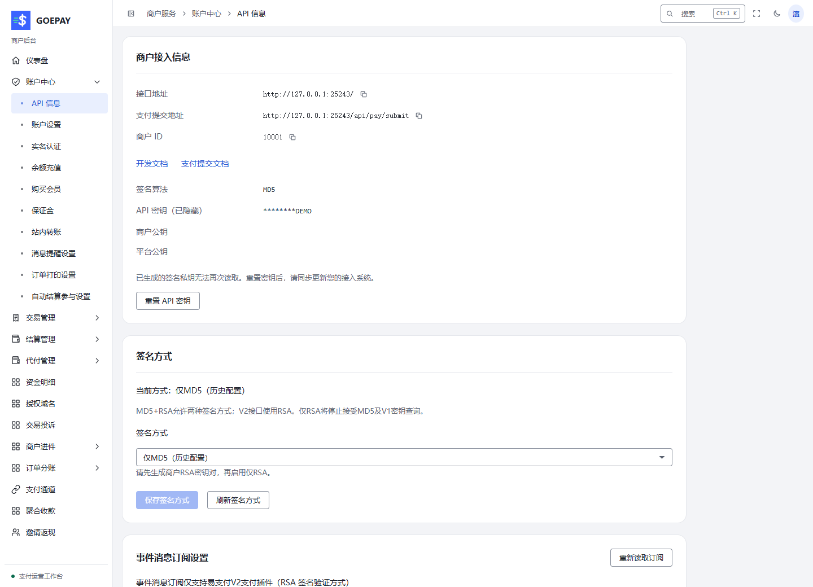

# API 信息、密钥与授权域名

按功能从[账号、安全与 API 接入](../modules/account-security.md)开始，查看本人配置与业务后端验签的完整交付路径。

**入口：账户中心 → API 信息**，路径 `/merchant/account/api-info`。请使用商户本人会话，管理员代登录不能替代受保护的接入资料操作。

## 交给开发人员的资料

| 资料 | 作用 |
| --- | --- |
| 接口地址 | 当前运营站点的 API 地址，不复制其他部署的地址 |
| 商户号 / PID | 标识当前商户，和后台登录账号不同 |
| 签名方式 | 按站点开放的兼容协议选择，与业务系统实现保持一致 |
| 商户签名资料 | 商户后端签名请求；MD5 密钥或商户自己的 RSA 私钥等按所选方式管理 |
| 平台公钥 | 核验平台签名；不能与商户公钥 / 私钥混用 |
| 通知及回跳地址 | 你的业务系统提供，通知是服务端处理，回跳是用户浏览器展示 |

完整参数、签名串与返回码以[官方开发文档](https://goepay.cc/doc/)为准。前端页面、收款码图片或聊天记录里不放私钥。

本地演示商户，未展示可用于实际请求的密钥或私钥。

## 获取、重置或切换密钥

1. 核对页面商户号，确认是本人账号。
2. 按页面的当前密码 / 二次确认要求进入密钥操作。
3. 需要新密钥时执行明确的重置 / 生成动作，一次展示后立即存入安全的服务器配置。
4. RSA 接入时核对商户公钥与自己保管的私钥是否配对。
5. 更新业务系统配置后先做模拟验签，核对新请求和回调。

重置或切换可能使旧签名请求失效，应安排双方切换，不通过恢复浏览器缓存找回旧密钥。页面提示重新登录时，按要求本人重新登录。

## 选择签名方式

页面提供的“MD5+RSA”允许相应兼容签名方式；V2 接口使用 RSA。“仅RSA”要求先配置匹配的商户 RSA 密钥资料，切换后不再接受 MD5 及相应 V1 密钥查询。先确认业务系统已完成切换，再保存；不要仅为消除提示而切换算法。

## 添加授权域名

**入口：授权域名**，路径 `/merchant/domain`。

点击新增，按页面格式填写实际业务域名及要求的资料。保存后查询其状态和范围；不要把某个演示站、接口路径或另一商户域名当作自己的授权。

授权域名不能替代 API 验签、通知地址校验或支付机构的产品域名配置。上线前分别核对这些项目。

## 接入检查顺序

商户身份 → 当前签名资料 → 正确接口地址 → 唯一商户订单号 → 参数签名 → 通知验签与幂等 → 主动查单兜底。只在浏览器收到成功页而未收到服务端确认时，不交付商品。
