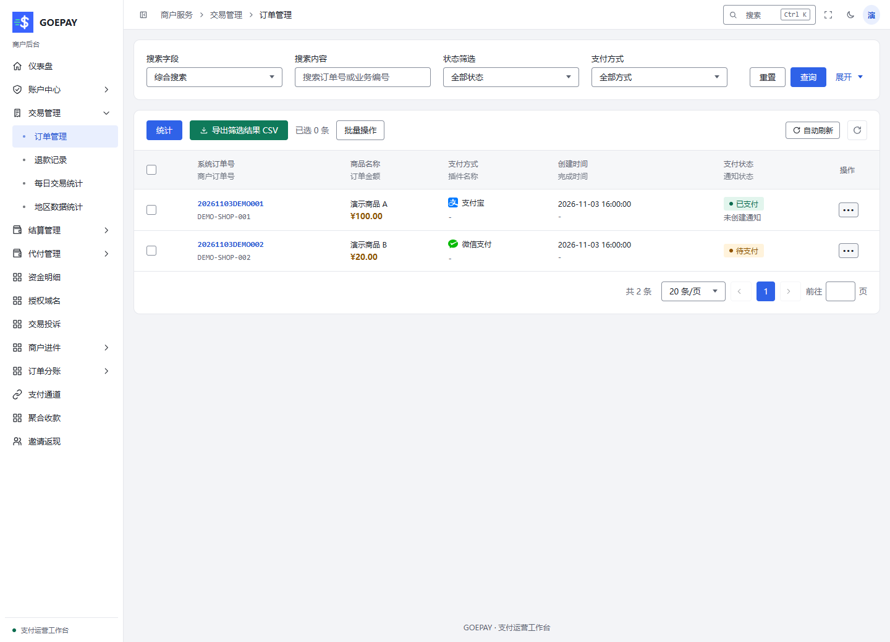
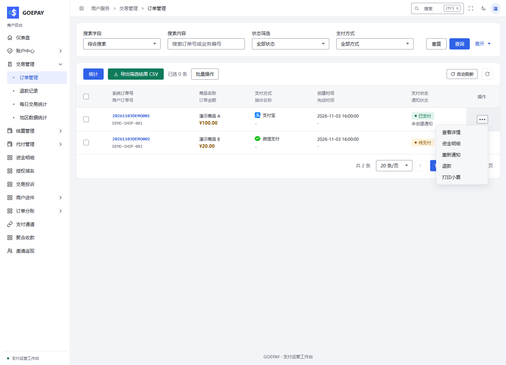

# 订单、通知与退款

按功能阅读[收款与订单](../modules/transactions.md)及[退款与售后退还](../modules/refunds.md)；本页说明商户可执行的订单动作。

**入口：交易管理 → 订单管理 / 退款记录**，路径 `/merchant/trade/order`、`/merchant/trade/refund`。

## 查订单

使用平台订单号、商户订单号、时间、方式或状态筛选，打开订单操作菜单查看详情。比较订单金额、实付、已退金额、支付时间、上游交易信息及通知结果。

本地合成订单，订单号、商品和金额仅用于展示字段。

## 操作菜单的含义

| 动作 | 使用场景 |
| --- | --- |
| 查看详情 | 查看原订单与支付信息 |
| 资金明细 | 按原订单跳到自己的关联流水 |
| 手动补单 | 在平台允许时查询未支付原单的机构结果，不重新扣款 |
| 重新通知 | 已支付但你的业务系统未正确接收通知时使用 |
| 退款 | 对已支付且仍有可退金额的订单申请退款 |
| 核对原退款 | 恢复结果未知或中断的原退款 |
| 退款记录 | 查看已关联的退款历史 |
| 打印小票 | 在打印权限、凭据及设备均满足时执行 |

菜单按原订单状态和平台允许的能力显示。普通商户没有管理员的任意改状态、冻结或删除权限。

本地演示菜单。实际按钮由订单状态、权限和配置决定。

## 已付款，业务系统没有更新

先查 GOEPAY 是否已支付：

- 平台仍未支付：保留原订单，使用允许的补单 / 查询，联系运营方核对回调。
- 平台已支付：核对你的通知地址、验签、响应和幂等业务更新；修复后再按权限重新通知。

重新通知不会再次扣款，但通知接收端必须防重复交付。详见[支付回调时序](../concepts/payment-flow.md)。

## 申请退款

1. 核对目标订单和剩余可退金额。
2. 从原订单选择退款，填写本次金额及必要原因。
3. 阅读确认提示后提交一次。
4. 进入原退款记录查看受理、处理中、成功、失败或未知状态。
5. 成功后核对累计已退金额及资金明细。

申请被受理不表示钱已经退给用户。结果未知时使用“核对原退款”，不要换退款号再申请一笔；商户无权限时由运营方处理，不借用管理员账号。
