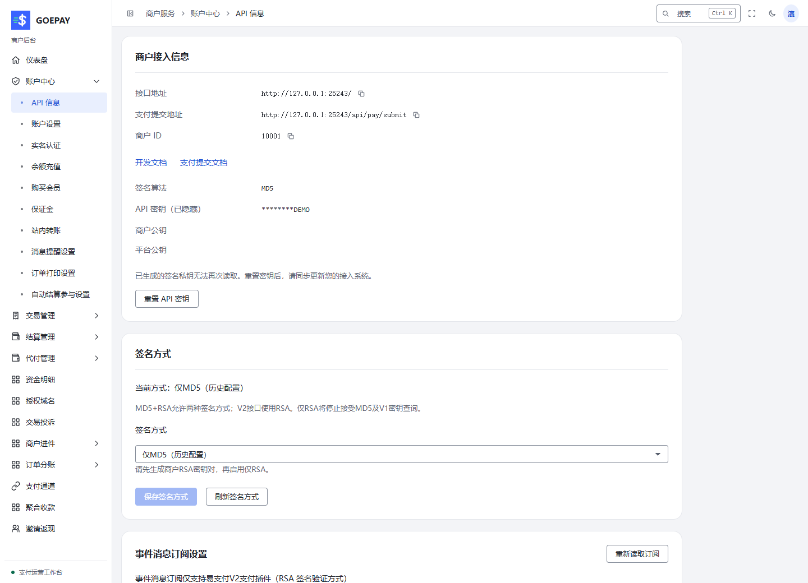

# 账号、安全与 API 接入

商户本人管理登录、验证和 API 签名资料，管理员管理运营账号及商户身份关系。本模块用于把“谁登录”“谁签名”“谁接收资金”分别配置清楚，再交付给实际使用者。

## 从哪里进入

| 任务 | 管理员入口 | 商户入口 |
| --- | --- | --- |
| 登录密码与本人安全 | 个人修改密码 `/admin/system/change-password` | 账户中心 → 账户设置 `/merchant/account/settings` |
| 管理员与菜单授权 | 系统管理 → 管理员列表 `/admin/system/admin-user`，超级管理员 | 无平台管理员授权入口 |
| 商户登录关系与签名资料 | 商户管理 → 商户列表 `/admin/merchant/merchant-list` 的对应操作 | 账户中心 → API 信息 `/merchant/account/api-info` |
| 授权域名 | 商户管理 → 授权域名 `/admin/merchant/domain` | 授权域名 `/merchant/domain` |
| 登录审计 | 系统管理 → 登录日志 `/admin/system/log` | 账户设置的本人登录记录 |

## 商户首次交付给业务开发

1. 本人登录，核对商户号和顶部身份。商户号 / PID 与登录账号不同；仅 API 商户资料也不自动附带后台登录账号。
2. 在账户设置修改交付密码，按页面完成 TOTP 或其他本人确认。需要可信手机、邮箱时使用独立绑定流程，完成验证码；普通联系资料不自动成为找回或通知身份。
3. 进入 API 信息，核对当前站点接口地址、商户号、签名方式和平台公钥。按当前密码及二次确认要求获取、生成或设置签名资料。
4. 将商户私钥或密钥放入业务后端的安全配置。RSA 使用自己的私钥签名，平台公钥用于验平台签名，两者不能混用。
5. 业务系统使用唯一商户订单号，完成请求签名、通知验签、幂等入账和主动查单；在模拟环境验证后，再交付当前有效配置。

## 接入关系图：后台登录与服务端签名分别验证

图中的商户后台会话和商户业务后端是不同入口。浏览器负责本人配置与查看，后端负责签名请求及接收通知，支付机构回调由平台核验。

<Diagram name="architecture" caption="接入关系：本人后台、商户业务后端与平台 API 的不同职责" />

## 密钥切换与签名方式

| 决定 | 操作顺序与结果 |
| --- | --- |
| 重置 MD5 密钥 | 明确重置后立即安全保存，安排业务系统切换并验签，旧请求可能失效 |
| RSA 接入 | 在后端保存私钥，配置配对商户公钥，核对平台公钥用途 |
| MD5+RSA | 按站点开放能力兼容对应方式；V2 接口使用 RSA |
| 仅 RSA | 先完成 RSA 配置和后端切换，再保存；随后不接受 MD5 及相应 V1 密钥查询 |
| 新增授权域名 | 填实际业务域名并查询归属和审核状态；不能替代验签、通知校验或机构产品域名配置 |

切换结果未知先重新读取当前状态，页面要求重新登录时由本人完成。管理员代登录用于排查界面，不能替代商户本人完成 API、实名和受保护资料操作。

## 管理员授权与异常登录

超级管理员新增运营账号时，填写登录资料并选择超级或受限管理员。受限账号按菜单授予必要范围，保存后由新账号本人登录，验证可见菜单与允许动作；菜单可见性和服务端授权共同决定操作能力。登录密码、资金密码、TOTP 分别设置，勾选开关不能代替本人绑定。

发现异常登录时记录时间、来源和账号，修改密码并检查绑定与会话；管理员结合登录日志定位。地区未知时保留未知，不据此猜测具体地点。正式退出使用退出入口，关闭网页不等于结束会话。

详细操作：[商户账户](../merchant/account.md)、[API 与密钥](../merchant/api.md)、[管理员账号](../admin/system.md#管理员列表)、[商户维护](../admin/merchants.md)。
