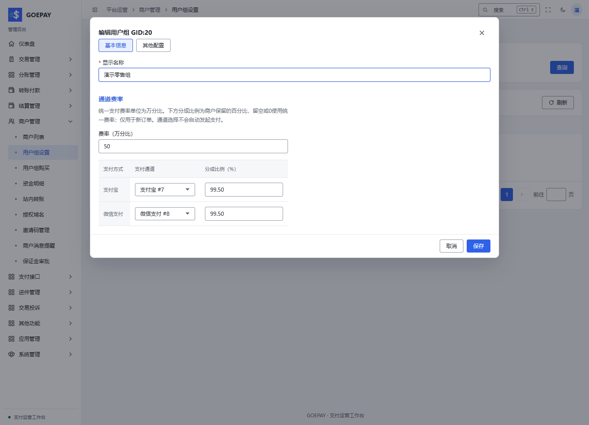

# 商户与用户组

管理员在这里建立商户身份、配置有效用户组并交付账号；商户在自己的账户中确认组别、会员期限和收款条件。一个可用商户需要同时具备登录身份、商户状态和收款授权，创建资料只是第一步。

## 从哪里进入

| 任务 | 管理员入口 | 商户入口 |
| --- | --- | --- |
| 新增、编辑、停用商户 | 商户管理 → 商户列表 `/admin/merchant/merchant-list` | 账户中心 → 账户设置 `/merchant/account/settings`，仅维护本人允许修改的资料 |
| 配置用户组及费率 | 商户管理 → 用户组设置 `/admin/merchant/group-list` | 支付通道 `/merchant/subchannel`，查看有效结果 |
| 会员购买及有效期 | 商户管理 → 用户组购买 `/admin/merchant/group-buy` | 账户中心 → 购买会员 `/merchant/account/groupbuy` |
| 邀请记录 | 商户管理 → 邀请码管理 `/admin/merchant/invite-code` | 邀请返现 `/merchant/invite` |

## 从开户到第一笔可用收款

1. **先确定是否需要后台登录。** 在商户列表点击新增商户。普通商户选择“商户账号”，提供手机号或邮箱及至少 12 字符的登录密码；有手机号时优先以手机号登录，否则使用邮箱。“仅 API（高级）”用于无需后台登录的接入方，保存 API 商户资料不会自动创建可登录账号。
2. **准备有效用户组。** 到用户组设置新增或编辑组，逐项检查支付宝、微信等方式的通道选择和分成比例。新组的支付方式可能默认关闭；保存后重新打开，确认所需方式确实开放。
3. **保存商户状态和业务条件。** 为商户选择正确组别，核对商户启用、登录启用、支付状态、手续费扣除模式以及需要的结算资料。这些开关分别控制不同能力。
4. **核对通道授权来源。** 有显式授权的商户按其授权范围使用；没有单独授权时，需要部署配置的公共默认收款池。用户组指定通道或轮询仍须落在允许范围内。明确的空授权列表不能当成“自动继承全部通道”。
5. **由商户本人验收。** 登录商户后台，查看商户号、组别、通道和有效费率，完成当前要求的实名、保证金及接入设置。最终应能用自己的身份创建模拟订单、查询原订单并确认账务。

### 开户流程图与交付时序图

流程图用于检查“开户还缺哪一步”；时序图说明运营方、商户和系统分别在何时完成配置、本人登录与验收。

<Diagram name="merchant-onboarding" caption="商户开户流程：资料、用户组、授权与收款验收" />

<Diagram name="merchant-onboarding-sequence" caption="商户开通时序：运营配置后，由商户本人完成受保护操作" />

## 容易填错的字段与决定

| 项目 | 如何决定与验收 |
| --- | --- |
| 分成比例 | `99.50%` 表示商户保留 99.50%，不能把 `0.50%` 手续费直接填入此栏；按方式分成留空或为 0 时使用统一费率 |
| 统一支付费率 | 单位为万分比，与百分比不同；以保存后的有效费用及订单快照核对 |
| 手续费扣除模式 | 余额扣费与订单加费会影响商户承担费用的方式，交付前明确告知 |
| 普通联系方式 | 资料页联系电话、邮箱不自动成为可信登录、找回或通知绑定身份 |
| 默认收款池 | 提供允许的收款来源；不会授予代付、自动结算或预授权权限 |
| 会员与组别 | 购买和到期会影响后续有效组；历史订单保留创建时的通道和费用 |

## 编辑、停用与交接后的检查

变更组别后创建一笔新的模拟订单，查看新策略是否生效，再抽查一笔历史订单，确认仍显示原通道与金额。停用登录、停用商户、关闭收款各有不同目的；处理“能登录但不能收款”时逐项核对，而不是反复重置密码。

管理员模拟登录仅用于查看商户视角，最长会话及身份替换以提示为准。API 密钥、实名、可信绑定与其他受保护操作由商户本人办理。对仅 API 商户没有登录账号的情况，应建立所需账号关系后再交付后台，不能把商户号当作现成登录名。

详细操作：[管理员商户维护](../admin/merchants.md)、[用户组与路由](../admin/groups.md)、[商户首次使用](../merchant/quickstart.md)、[会员与保证金](../merchant/services.md)。
