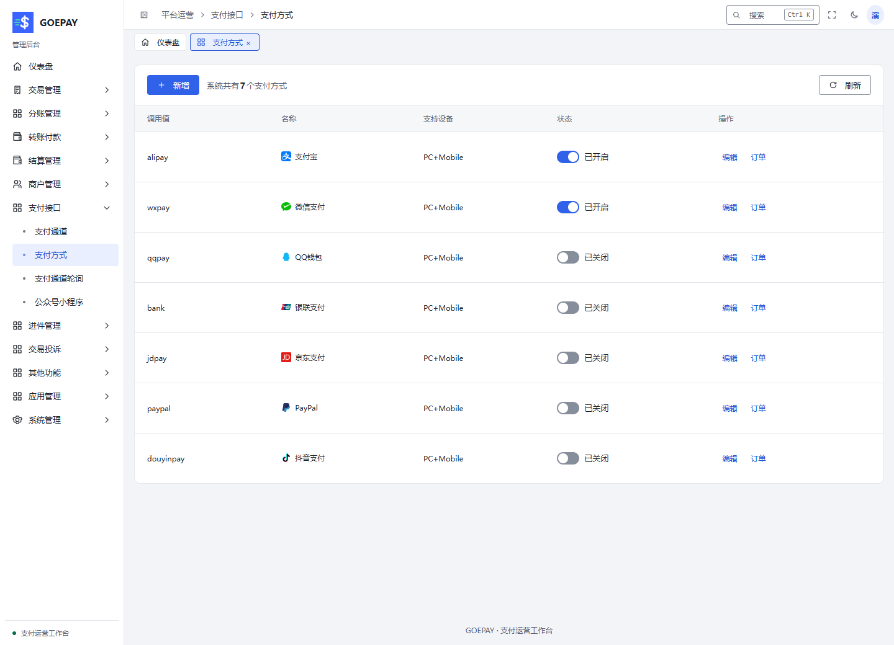

# 支付方式、通道与路由

管理员负责配置支付机构、应用和路由，商户查看自己的有效通道。使用本模块把“方式目录存在”落实为“该商户能通过指定产品收款”。

## 从哪里进入

| 配置对象 | 管理员入口 | 商户入口 |
| --- | --- | --- |
| 支付机构账户与产品 | 支付接口 → 支付通道 `/admin/payapi/pay-channel` | 支付通道 `/merchant/subchannel`，查看允许范围 |
| 方式名称、设备和开关 | 支付接口 → 支付方式 `/admin/payapi/pay-type` | 同上，查看实际开放方式 |
| 多通道选择 | 支付接口 → 支付通道轮询 `/admin/payapi/pay-roll` | 按有效规则使用，无平台路由配置权 |
| 微信应用身份 | 支付接口 → 公众号小程序 `/admin/payapi/pay-weixin` | 按产品要求完成对应应用授权 |
| 组内策略 | 商户管理 → 用户组设置 `/admin/merchant/group-list` | 查看最终通道及分成比例 |

## 开通一种新的收款方式

1. 在支付机构侧确认已开通所需产品。电脑扫码、手机网页、公众号、小程序、被扫和预授权各有产品条件，不能靠改一个显示名称互相代替。
2. 到支付通道新增或编辑，选择支付插件、支付方式与产品，填写所属账户的 AppID、商户号及对应密钥、公钥或证书。保存后重新读取，确认凭据状态和通道启用状态。
3. 到支付方式核对名称、支持设备及开放状态。`PC+Mobile` 表示设备入口范围，具体支付形式仍取决于所选通道产品。
4. 给目标商户配置有效授权来源，再在其用户组中选择默认、指定通道或轮询。公共默认收款池由部署配置提供，新增用户组不会改写该池。
5. 由演示商户查看支付通道，核对方式、通道、费率和可用状态。使用本地模拟或服务商沙箱检查创建原单、回调、查单和退款，订单中应记录实际选中的通道。

## 路由流程图：为什么选中它，为什么没有候选

<Diagram name="channel-selection" caption="通道选择流程：有效授权、用户组策略与运行条件逐层筛选" />

| 选择 | 生效条件与预期结果 |
| --- | --- |
| 关闭该方式 | 新收款不能使用该方式；检查新用户组时首先确认此项 |
| 默认 / 继承 | 商户显式授权或公共默认池确有允许来源，组内没有关闭 |
| 指定通道 | 通道存在、启用、产品匹配，且属于商户允许范围 |
| 轮询组 | 轮询启用、成员类型相符、权重或优先级有效，每个成员仍受授权和限额约束 |
| 商户子通道等高级策略 | 使用页面提供的选项，并核对实际产品及权限，不手填特殊编号 |

没有可用通道时，按“商户和支付状态 → 实名及保证金 → 授权来源 → 用户组 → 轮询成员 → 金额、时段及风控限制”检查。一个明确的空授权列表不会继承默认池。收款来源也不自动授权付款或预授权。

## 配置轮询并验收

新建轮询组，选择同一支付方式的有效成员，填写策略及权重；加权模式应有有效权重。保存并核对成员后启用，再在用户组选择该组。用新模拟订单观察实际通道和金额，确认符合预期；停止某个成员后，再检查新订单候选变化。

已有支付材料的订单继续沿原通道查询和处理。调整轮询、费率、应用或用户组，不能让另一个通道接管原支付请求。

## 费率和应用资料怎么核对

通道或用户组显示的“分成比例”是商户保留百分比，例如 99.50%；它对应的费用比例不能直接原样填入同一栏。用户组按方式另设比例时按有效规则生效，留空或 0 使用统一费率，统一费率单位为万分比。实际金额以原订单费用快照为准。

微信 OpenID 属于具体 AppID；公众号、小程序、结算接收身份必须核对应用归属。支付宝商户私钥与平台公钥也有不同用途。页面“测试”可能创建真实支付请求，验收前确认当前选择的是模拟环境或已授权沙箱。

详细操作：[管理员通道配置](../admin/channels.md)、[用户组路由](../admin/groups.md)、[商户通道与收款码](../merchant/collection.md)。后续收款与原单处理见[交易模块](./transactions.md)。
