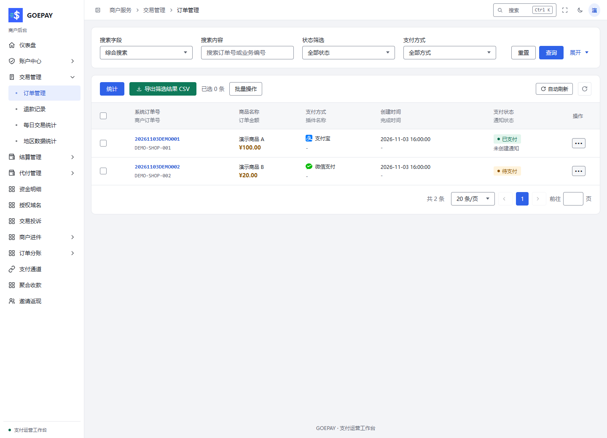

# 收款与订单

商户用 API 或聚合收款码发起收款，并按原订单交付商品；管理员跨商户核对支付、通知和异常。这里处理收款事实，退款、结算和代付分别进入对应模块。

## 从哪里进入

| 任务 | 管理员入口 | 商户入口 |
| --- | --- | --- |
| 查询与处理订单 | 交易管理 → 订单管理 `/admin/trade/order` | 交易管理 → 订单管理 `/merchant/trade/order` |
| 创建或维护聚合码 | 其他功能 → 聚合收款码样式 `/admin/other/onecode`，维护平台样式 | 聚合收款 `/merchant/onecode`，维护自己的收款码 |
| 查看有效通道 | 支付接口 → 支付通道 `/admin/payapi/pay-channel` | 支付通道 `/merchant/subchannel` |
| 获取 API 资料 | 商户列表的凭据管理，按权限维护 | 账户中心 → API 信息 `/merchant/account/api-info` |

## 完成一笔收款

1. 确认商户状态、有效通道和费率已就绪。API 接入先取得当前站点地址、商户号和签名资料，业务系统为每笔业务使用唯一商户订单号。
2. 发起 API 请求，或在聚合收款中新建收款码，填写名称、展示信息及页面允许的金额条件，选取样式并保存。核对公开链接或二维码的商品、金额和收款身份。
3. 用户支付时，电脑端按产品显示完整二维码，手机端按产品跳转支付应用；应用内浏览器和小程序还需匹配对应身份授权。
4. 在订单管理查询原订单，核对支付状态、实付、实际通道、上游交易号和支付时间。商户系统收到平台通知后验签并幂等更新业务，也可主动查单确认。
5. 比对订单与关联资金明细后交付商品。支付成功页、声音提示或截图不足以确认支付；资金可用与是否已结算另行判断。

## 支付时序图：支付成功与通知成功是两个结果

这张时序图按时间展示用户、商户系统、GOEPAY 和支付机构的交互。重点检查上游支付确认、平台入账和商户通知三个位置，不能用浏览器回跳代替服务端确认。

<Diagram name="payment-sequence" caption="支付时序图：原单下单、支付确认、入账与商户通知" />

## 查单时看哪些字段

| 字段 | 用途 |
| --- | --- |
| 平台订单号 / 商户订单号 / 商户号 | 定位同一笔业务；管理员遇到同号时同时限定商户 |
| 订单金额、实付、已退 | 分别核对计费和剩余可退范围，不用一个金额代表全部 |
| 支付方式、实际通道、上游交易号 | 锁定原支付身份与原机构请求 |
| 支付时间、通知状态和尝试结果 | 判断钱是否已付、业务系统是否已收到并确认 |
| 冻结、归档、预授权信息 | 解释管理状态，区分收入限制与真实支付事实 |

## 按症状处理异常

| 看到的情况 | 下一步与预期结果 |
| --- | --- |
| 用户称已付，平台未支付 | 核对原单与机构证据，使用允许的手动补单 / 查询；由原通道结果确认 |
| 平台已支付，商户业务未更新 | 检查通知地址、验签、响应和幂等逻辑，修复后重新通知；不会再次扣款 |
| 请求中断或结果未知 | 保留原订单号，查原单；原材料已生成后不换通道另建替代请求 |
| 收入被冻结 | 管理员核对冻结原因及原周期，按权限解冻，再查资金明细；支付事实不因冻结消失 |
| 订单被归档 | 使用归档筛选与恢复；恢复展示不会重新付款或入账 |
| 详情显示预授权 | 分别核对授权冻结、扣款和撤销；授权冻结不能当作普通支付成功 |

管理员的“改已完成 / 改未完成”属于管理动作，不代表支付机构扣款或退款。批量处理应核对选中数量、每条状态与执行结果；部分成功或未知时按原批次逐条恢复。商户菜单只提供自身被允许的查询、退款、通知、打印等动作。

详细操作：[管理员订单处理](../admin/orders.md)、[商户订单操作](../merchant/orders.md)、[聚合收款](../merchant/collection.md)、[API 接入资料](../merchant/api.md)。售后退还见[退款](./refunds.md)，业务系统通知见[消息与通知](./notifications.md)。
